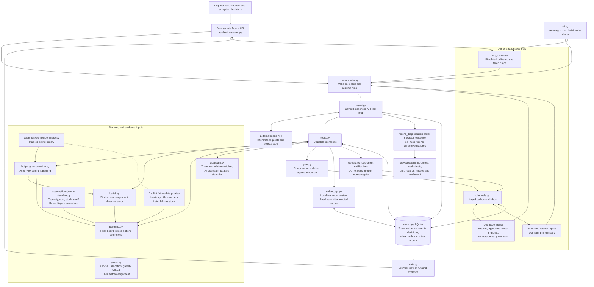

# Trex architecture

The browser and CLI share the same agent and tools. This diagram describes the current prototype, including simulation boundaries.

## Boundaries that matter

- The model chooses tools and words. The allocation solver chooses allocated quantities. An offer or order request is not itself a delivered allocation.
- A person handles material ambiguity and policy exceptions. Some limits are enforced in tools; others remain agent instructions. The CLI supplies automatic approvals and cannot demonstrate independent exception resolution.
- The numeric gate checks numeric correspondence, not meaning or commercial truth. The diagram explicitly shows generated notifications that bypass that gate.
- Persisted turns and keyed writes support retries and restart recovery. External messaging is not a transactional, guaranteed-delivery system.
- Delivery proof is simulated apart from one live team phone. Even that live phone demonstrates evidence capture, not a verified commercial delivery.
- Capacity, cost, stock, shelf life, retailer types and upstream records are stand-ins. Future bills are used in explicit order/stock/reply proxies, so replay results are not leakage-free forecasts or measured savings.

The Mermaid source renders in a repository viewer that supports Mermaid. Use the public file URL as the submission's diagram link only after checking that it opens without signing in.
